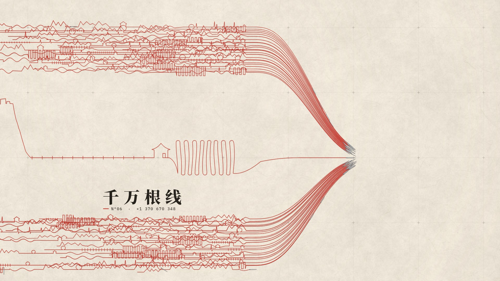

# 经纬 · Warp & Weft

**一支 30 秒的国庆动态影像。** 1920×1080 · 60 fps · H.264 + AAC · 原创配乐

成片：[`dist/national-day-2026.mp4`](dist/national-day-2026.mp4)


---

## 主题

经纬，是织物的经线与纬线，也是地图上的经度与纬度。

每一个人的一生，都是一根线：是值守时的心跳，是山河的轮廓，是国庆长假的归途，是秋天田里的垄。千万根这样的线汇到一起，织成了国，也织成了家。

国旗在这支片子里不是一个现成的图形，而是被**织出来**、被**绣上去**的：六十根经线，四十根纬线，五颗星用金线一针一针缎绣。七十七针，是 1949 到 2026 的七十七年。

最后镜头钻进布里的一根线，顺着它一路回到开头那个针眼——那根线就是你。

> 一根线 / 是心跳 / 是山河 / 是归途 / 是丰年 / 千万根线 / 织成经纬 / 七十七年 一针一线 / 你我皆经纬 / 国庆快乐 · 愿山河锦绣 万家团圆

祝福不只给国家：给每一个在路上的人，每一个守着岗位的人，每一个回家的人。



## 导演法则

| 法则 | 在片中的执行 |
|---|---|
| **一线到底**（无剪辑） | 全片是一个连续镜头。所有转场都由线本身完成：心电图的尖峰长成山、山脊落成铁轨、铁轨通向一座房子、房子后面犁出田、所有人的线汇成经线。 |
| **线即弦** | 声音里每一次拨弦，画面里都有一根线在振动。针穿过经线时，经线像古筝的弦一样被依次拨响；纬线每过一梭，就是一串刮奏。 |
| **原生动作** | 只允许线、针、布、纸会有的动作：刺穿、拉出、绷紧、拨动、缝、织、打纬、起伏。没有淡入淡出，没有弹跳缩放。文字也是"缝"出来的——每个字由一根红线从上往下带出。 |
| **统一材质** | 亚麻纸、朱砂红线、金线、钢针、墨。没有发光字、没有光晕、没有渐变天空、没有烟花。光只来自一个方向（左上），所有阴影都服从它：线离纸越高，影子越远越淡。 |
| **钩子** | 开场 0.6 秒完全静默，只有纸的微距。纸面先微微隆起，然后针尖从下面刺穿——第一个声音是针穿纸，第二个声音是线被拉紧时的那一声拨弦。 |
| **静音节奏** | 高潮前一拍（19.375–20.0 s）声音与画面同时完全停住。然后大鼓落下，金针刺入第一颗星。 |
| **首尾呼应** | 结尾回到同一个针眼、同一根线、同一个构图，用同一个音（低音 D）再拨一次。开头的"一根线"，在结尾成了"你我皆经纬"与"国庆快乐"之间的那道分隔线。 |

## 结构与声画对位

96 BPM——一个心动时的心率。每小节 2.5 秒，12 小节正好 30 秒。画面的每个节点都直接读取乐谱里的事件时间（`src/score.js`），不存在"大概对上"。

| 小节 | 时间 | 画面 | 声音 |
|---|---|---|---|
| 1 | 0–2.5 | 纸面隆起 → 针刺穿 → 飞出拉线 → 绷紧 | 静默 → 针穿纸 → 气流 + 轻刮奏 → **低音 D 拨弦** |
| 2 | 2.5–5 | **是心跳**：心电图，R 波尖峰 | 底鼓就是心跳，每个尖峰落在底鼓上 |
| 3 | 5–7.5 | **是山河**：山峰高度 = 旋律音高；长城垛口 | 每个峰一个音；垛口 = 十六分沙锤；烽火台 = 木鱼 |
| 4 | 7.5–10 | **是归途**：铁路（地图符号），第四拍画出一座房子 | 每根枕木 = 一个十六分音；房子 = "回家"动机 |
| 5 | 10–12.5 | **是丰年**：牛耕式犁田，一个十六分一条垄 | 每条垄一个拨弦琶音，声像随犁向左右摆 |
| 6 | 12.5–15 | **千万根线**：拉远，59 根别人的线；汇入织机 | 每根线出现时一声拨弦（级联）；全部绷紧时一次上行刮奏 |
| 7–8 | 15–19.4 | **织成经纬**：一梭一行，打纬，越织越快 | 每梭 = 一串刮奏（针拨过经线）+ 木鱼打纬；鼓滚加速 |
| — | 19.4–20 | 静止 | **完全静音** |
| 9–10 | 20–25 | 金线缎绣五星；布随底鼓起伏；七十七针 | 大鼓 + 编钟：大星落在重拍，四颗小星各一个钟声；针刺声随针脚 |
| 11 | 25–27.5 | 钻进一根经线，翻转 90°，顺着它一路退回开头 | 鼓全部撤出；下行刮奏 = 倒带 |
| 12 | 27.5–30 | 同一根线再被拨响；**国庆快乐** | 同一个低音 D；每个字一个泛音 |

## 声音

所有声音都是代码合成的，没有采样、没有素材库：

- **古筝**：Karplus–Strong 物理建模，分数延迟线（全音域音准误差 < 1 音分），按弦的起音音高回落，长音带揉弦。泛音用近乎正弦的玻璃质音色。
- **编钟**：非谐波分音加法合成，每个分音独立衰减，带槌击噪声。
- **堂鼓**：圆形膜振动模态 + 鼓槌噪声；底鼓、拍手、沙锤、木鱼各自建模。
- **弦乐铺底**：PolyBLEP 锯齿波去混叠、失谐、滤波。
- **拟音**：线划过纸的沙沙声，响度由画面里针的**实际速度**驱动，声像跟着针在画面中的位置走；金线刺绣和七十七针各有一串针刺声。
- **混音**：Freeverb 混响、乒乓延迟、侧链压缩、总线 EQ、推子自动化（主歌退后，给高潮留空间）、胶水压缩、前瞻限幅。整合响度 −13.4 LUFS。

## 画面技术

- 每一帧都是时间 `t` 的纯函数（`src/scene.js`），任意帧可独立渲染，因此可以并行。
- **线**按屏幕上的粗细分级渲染：接触阴影 → 圆柱明暗 → 捻度 → 飞毛。
- **纸**是一张无缝程序化纹理，按缩放在两个八度之间交叉淡化，从 17× 微距到 0.25× 远景都不会糊。
- **织物**是真正的平纹组织：经纬交错按 (i + j) 奇偶决定上下，布面起伏按坡度重新打光。
- **国旗**严格按 GB 12982 几何：大星中心 (5, 5) 半径 3，四颗小星各有一角指向大星中心。星用分面缎绣：每个角沿轴线分成两半，两半针脚方向不同，所以受光不同。
- **运动模糊**：180° 快门，按画面实际位移决定子帧数（最多 28 个），真实时间采样平均，不是滤镜。
- 颜色按 BT.709 矩阵转换并标记。

## 构建

需要 Node 18+。

```bash
npm install
npm run audio     # 合成配乐 → out/soundtrack.wav + dist/soundtrack.{webm,m4a}
npm run video     # 并行渲染 + 编码 → dist/national-day-2026.mp4（4 核约 8 分钟）
npm run stills -- 13.9 22.2 29.5   # 渲染指定时刻的单帧 → out/stills/
npm run preview   # 实时预览 → http://localhost:8026/preview/
```

实时预览在浏览器里用同一份场景代码逐帧绘制，并与配乐同步（空格播放/暂停，可拖动）。成片以 MP4 为准。

修改了屏幕上的中文文字后，需要重新生成字体子集：

```bash
pip install fonttools
curl -L -o NotoSerifSC.ttf "https://raw.githubusercontent.com/google/fonts/main/ofl/notoserifsc/NotoSerifSC%5Bwght%5D.ttf"
python3 scripts/fonts.py NotoSerifSC.ttf
```

## 目录

```
src/core/       节拍网格、缓动、随机数
src/score.js    乐谱：所有声音事件，以及画面读取的同步表
src/world/      世界几何：主线旅程、59 根人群线、织机与国旗、文字
src/camera.js   一镜到底的摄影机
src/draw/       纸、线、针、文字的渲染
src/scene.js    合成一帧
src/audio/      合成器、乐器、拟音、混音
scripts/        渲染音频 / 视频 / 单帧 / 预览服务 / 音频频谱检查
assets/fonts/   思源宋体（Noto Serif SC）子集、IBM Plex Mono —— 均为 SIL OFL 授权
```
