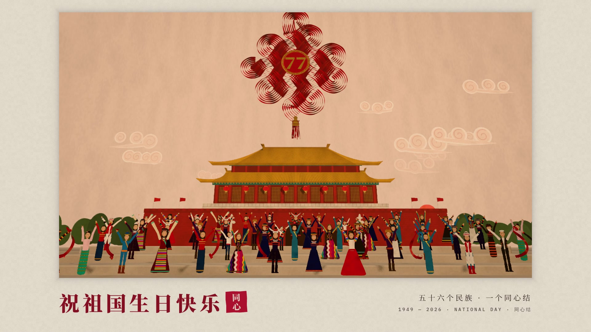

# 同心结 · The Knot of One Heart

**一支 30 秒的国庆祝福影像。** 1920×1080 · 60 fps · H.264 + AAC · 原创配乐（全部由代码合成）

成片：[`dist/tongxin-national-day-2026.mp4`](dist/tongxin-national-day-2026.mp4)



根据分镜脚本《AI 国庆视频分镜 0929》改编：六场戏、一根红绸、五十六个民族、一个同心结。整体创意与分镜顺序不变，在材质、转场和结尾上做了导演处理（见下）。

---

## 一个统一的材质世界：剪纸里唯一的丝绸

整个世界是**剪纸与卡纸**做的：葡萄架、火焰山、圣湖、经幡、蒙古包、骏马、瀑布、竹林、熊猫、天安门、祥云、人——每一样都是有厚度、有纤维、有切口斜面的纸片，用针钉在关节处，像皮影和纸雕一样活动；人物转身时会露出纸背的白。一个太阳，一个方向的光，一切阴影服从它。

在这个纸的世界里，**只有一种织物：红绸**。它是唯一有光泽、会透光、会飘的东西（各向异性缎纹高光、经纬织纹法线、背光透红）。它从一个民族的手里交到下一个民族手里，一根变两根，两根变五根，五根变五十六根，最后在天安门上空编成一个同心结。

剪纸是各民族共有的民间手艺，红绸是节庆，结是"同心"。材质本身就是主题。

## 导演法则

| 法则 | 在片中的执行 |
|---|---|
| **钩子** | 第一帧就是一个红绸圈的微距，满屏的缎纹与景深。0.47 秒，手鼓一声 DUM，红绸甩开，焦点拉到后面——维吾尔族姑娘已经在葡萄架下飞速旋转。 |
| **一根红绸不断** | 全片没有一个"硬切"：每一次换场都藏在红绸或纸里——红绸飞上天钻进云层，俯冲下来就是圣湖；红绸扫过镜头，就到了草原；纸做的雨帘合上，打开是苗寨的瀑布；五根红绸冲上天，落下来就是五十六个民族。 |
| **原生动作** | 纸只做纸会做的事：关节转动、翻面、层叠、滑动；红绸只做绸会做的事：飘、甩、拖尾、扭转、穿插、编织。没有淡入淡出、没有弹跳缩放、没有发光字、没有光晕、没有渐变天空、没有烟花。 |
| **匹配剪辑的万花筒** | 第五场红绸"锁"在镜头里一直流动，世界在它后面按拍子换：第 10 小节每拍一换，第 11 小节每八分音符一换，第 12 小节每十六分音符一换。每个世界里都有一只手伸进同一个位置、碰到同一条红绸、加进自己的一根——红绸一刀比一刀粗，汇成一条河。 |
| **静音节奏** | 同心结收紧之前的最后一拍（25.78–26.25 s），声音完全消失，画面进入慢动作，最后一个环在寂静中慢慢合上。下一拍大锣与大鼓落下，结猛地收紧，金线绣的 **77** 被"盖"进结心。 |
| **首尾呼应** | 开头是一根红绸的一个圈，结尾是五十六根红绸的一个结；开场甩出第一根红绸的维吾尔族姑娘，就站在全家福的第一排。右上角的"红绸"计数从 01 数到 56。 |
| **结尾是一张照片** | 快门声响起，画面定格；照片被裱到纸上，下方一个字一个字落下「祝祖国生日快乐」，最后按下一方"同心"朱印。 |

## 六场戏与声画对位（128 BPM，16 小节）

| 时间 | 小节 | 画面 | 声音 |
|---|---|---|---|
| 0–0.47 | 1 | 红绸圈的微距，浅景深 | 手鼓指滚，渐强 |
| 0.47–3.75 | 1–2 | DUM：红绸甩开，吐鲁番葡萄架下，维吾尔族姑娘旋转、每拍一次"移颈" | 手鼓 DUM；热瓦普沿"希贾兹"音阶（D 调）上行；每一次移颈都是一声 TAK |
| 3.75 | 3 | 手腕一甩，红绸飞上天；镜头拉开，鼓手们在敲，镜头追着红绸穿过葡萄叶钻进云层 | 热瓦普快速上行、红绸破风声 |
| 5.4–9.3 | 4–5 | 从云里俯冲，圣湖、雪山、经幡；藏族姑娘的长袖碰到红绸（7.5 s），长袖里又飞出一根 | 号角低音、骨笛旋律；碰绸时一声铃 |
| 9.3–12.9 | 6–7 | 红绸扫过镜头：呼伦贝尔，贴地广角侧跟骑手；套马杆一挑，第三根红绸；天色转暗，纸做的雨帘合上 | 马蹄三连音、马头琴；套马杆一声脆响；雨声 |
| 12.9–16.9 | 8–9 | 雨帘变成瀑布：苗族姑娘银角一跳，**升格慢动作**，银冠上滑出第四根；凤尾竹林里的傣族孔雀舞，第五根；熊猫丢下竹子拍红绸 | 银铃；慢动作时节拍抽空、铃声降八度拉长；葫芦丝与象脚鼓；熊猫两声拨弦 |
| 16.9–22.5 | 10–12 | 红绸锁在镜头里，世界按拍子换：壮族抛绣球、朝鲜族荡秋千、彝族火把 → 哈尼、哈萨克、回、满、白、纳西、侗、黎 → 十六个民族的织物图案化成万花筒 | 全体乐队同奏主题；鼓点与剪辑同步：拍 → 八分 → 十六分 |
| 22.5–24.4 | 13 | 红绸的河像幕布一样升起：下面是一床五十六块的"百家被"；每一块上升起一根红绸，从镜头两边冲上来；幕布又落下 | 大锣、低音下潜、长 riser |
| 24.4–25.8 | 14 | 幕布拉开，黎明的天安门；五十六根红绸飞上天，一上一下编出盘长结 | 全奏一击；古筝顺着编织的方向上下拨奏，针穿布的细声 |
| 25.78–26.25 | 14.4 | 最后一个环慢慢合上 | **完全静音** |
| 26.25 | 15 | 结猛地收紧，金线 77 盖进结心，流苏甩下 | 大锣 + 大鼓 + 全奏 |
| 26.7–28.1 | 15 | 镜头吊臂下降：五十六个民族的人在广场上举起双臂 | 人群欢呼、锣鼓、主题 |
| 28.13–30 | 16 | 快门，定格，裱成一张全家福；「祝祖国生日快乐」；朱印 | 快门声；七个字七声古筝；落印一声，钟声收尾 |

## 技术

- **画面**：three.js（WebGL2）在无头 Chromium 中离线逐帧渲染，每一帧都是时间 *t* 的纯函数。所有纸片都是运行时在 canvas 上画出来的（纸纤维法线、色斑、切口斜面高光与阴影），没有一张外部图片。
  - 红绸：身体严格复现"头"走过的路径（像蛇，不是样条），叠加行波与扭转；材质是各向异性缎面 + 织纹法线 + 背光透射。结里的五十六根红绸是 8 股 × 7 根，沿盘长结的路径一上一下交错。
  - 景深：散射式聚焦（金角采样）；运动模糊：真正的 180° 快门，快速段每帧 3–4 次子帧平均。
  - 纸人：正面剪影 + 针钉关节，手的位置用解析正向运动学计算，红绸可以"握"在手里。
- **声音**：全部由代码合成，没有任何采样：手鼓、热瓦普、古筝（Karplus–Strong 拨弦）、骨笛、马头琴（弓弦）、葫芦丝、马蹄、银铃、大锣、人群欢呼（56 个带共振峰的声音）、快门、落印。混音、混响、侧链、限幅也都在代码里完成。

## 运行

```bash
npm install
npm run tongxin:audio                 # → films/tongxin/out/soundtrack.wav, dist/soundtrack.{m4a,webm}
npm run tongxin:video                 # → films/tongxin/dist/tongxin-national-day-2026.mp4（约 1.5 小时，CPU 渲染）
npm run tongxin:stills -- --sheet 1 5 12 17 26 29   # 任意时间点的静帧 / 联络表
npm run tongxin:preview               # 本地实时预览（需要真 GPU），点击画面开始
```

`render-video.js` 支持 `--from/--to`（秒）、`--workers`、`--samples`（基础子帧数）、`--crf`。

字体：Noto Serif SC（按片中用到的字子集化，`scripts/fonts.py`）与 IBM Plex Mono，均为 SIL OFL。
